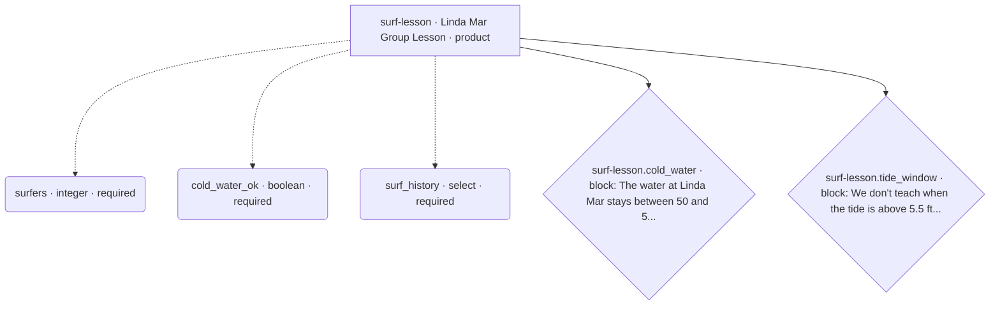

# scopegraph

**Agentic-commerce scoping and checkout for any service business — deterministic, with no AI at runtime.**

Model what you sell, what you need to know about a buyer, what you refuse, and what it costs — as YAML files you own. scopegraph turns that model into an API your website (HTTP) and AI agents (MCP) can call: buyers get asked the right questions in the right order, hear your real refusals, and receive an exact, tax-aware quote they can pay. Every decision comes from a rule engine using exact arithmetic — never a language model guessing.

It's yours: MIT licensed and self-hosted, with no platform in the middle and no per-transaction fee. Payments, if you turn them on, go to your own Stripe account.

## What an agent experiences

A buyer's agent calls the `scope_offering` tool. Every call returns exactly one of five outcomes — the next question, a refusal, a quote, an input error, or unavailable — never a partial answer:

```text
Agent        Book a group surf lesson for this Saturday.
scopegraph   needs_input — "How many people are surfing?"      (one question at a time)
Agent        Three.
scopegraph   needs_input — "Is everyone happy to spend two hours in 50-58°F water?"
Agent        One of us isn't.
scopegraph   blocked — "The water at Linda Mar stays between 50 and 58°F all year,
             so every surfer needs to be comfortable in the cold"   (your rule, verbatim)
Agent        Then just the two of us; we're both fine with cold water.
scopegraph   needs_input — "How much surfing has the group done?"
Agent        Never surfed.
scopegraph   qualified — $228.90: 2 × $95.00 + $20.00 weekend surcharge + $18.90 tax
Agent        pays the quote: create_payment_link → buyer pays on Stripe → you approve → done
```

The engine asks because it refuses to guess: a rule whose answer is missing is *unknown*, so it asks the buyer instead of blocking or assuming. Money is computed with exact arithmetic and fail-closed pricing — if a price can't be computed it errors, it never silently under-charges.

## Quickstart

Needs Node 22.12 or newer (`.nvmrc` included). Click **"Use this template"** to get your own private repository, so your prices and policies stay private, then:

```bash
npm install

# try the starter business — it ships green:
npm run validate                                # catalog compiles clean
npm run scenarios                               # its tests pass
npm run simulate -- surf-lesson --interactive   # play the buyer in your terminal
npm run dev                                     # serve HTTP + MCP on :3000, reloads on save

# make it yours — replaces catalog/ and scenarios/ with a blank business:
npm run sg -- init --name "Harbor City Cleaning"
```

The starter is **Sea Stack Surf School**, a fictional surf school in Pacifica, CA: three offerings in `catalog/`, tested by `scenarios/`. `init` replaces it with your business; a copy stays in [`examples/sea-stack-surf/`](examples/sea-stack-surf/).

`npm run sg -- <command>` runs the scopegraph CLI (`init`, `validate`, `test`, `simulate`, `graph`, `serve`, `doctor`, `orders`, …). Something off? `npm run sg -- doctor` checks your setup and says what's wrong.

### Connect it

Once it's running (at `http://localhost:3000` locally, or your deployed URL):

- **AI agents:** add `<your-url>/mcp` as an MCP server. For Claude Desktop, `npm run --silent sg -- mcp-config` prints a ready-to-paste config.
- **Your website:** `GET <your-url>/api/offerings`, then `POST <your-url>/api/offerings/<id>/scope` until you get a quote.

Details: [`docs/connecting.md`](docs/connecting.md).

## Model your business with your coding agent

Point your coding agent at [`AGENTS.md`](AGENTS.md). It contains the whole loop: interview you, write scenarios from your own words first, then the catalog YAML, then iterate `npm run validate` / `npm run scenarios` / `npm run simulate` until green. Sample prompt:

> Read AGENTS.md. Interview me about my business — what we sell, what we need to know about a buyer before accepting, what we refuse, and our real prices. Then replace catalog/ and scenarios/ with my business (don't invent numbers or policies), and keep validate + scenarios green. Finish by summarising what buyers will be asked, refused, and charged.

[`examples/`](examples/) has more businesses — tours, wellness, consulting, pet services and more — showing how the format handles different kinds of pricing.

## What buyers can see

Your scoping logic stays on your server. By default (progressive disclosure), buyers and their agents see only what a good receptionist would say, one step at a time:

| Buyers see | Buyers never see |
| --- | --- |
| Your offerings, descriptions and "from" prices | Your rules and the conditions behind them, or their ids |
| One question at a time, with only what's needed to answer it (label, type, allowed values) | Your full intake form up front |
| Your refusal message, word for word | Pricing formulas, tiers, margins and internal settings |
| The final quote, line by line, plus the optional add-ons (`addOns`) they could still choose | Server-side facts (tide, capacity, VIP status), your YAML files, the compiled graph, and engine traces (off unless you set `EXPOSE_TRACE=true`) |

To publish every question and add-on up front instead, set `disclosure: menu` in `catalog/business.yaml`; `describe_offering` then returns them all.

Every route is rate-limited per client. As with any quote form, someone patient could still probe a rule by trying many inputs; the limits slow that down rather than make it impossible.

## The five ideas

A catalog is `catalog/business.yaml` (currency, tax, timezone) plus one file per offering in `catalog/offerings/`. Five concepts cover almost everything — shown here for a house-cleaning business:

**1. Offerings — what you sell.** One file per product or package, with a price (flat, or per unit).

```yaml
# catalog/offerings/deep-clean.yaml
name: Deep clean
description: Top-to-bottom clean of a home, priced per bedroom.
date: required   # the buyer gives a date, so date-driven prices (isWeekend) can apply
price: { amount: 120, per: bedrooms }
```

**2. Questions — what you need to know.** Asked in the order written, until the engine can decide.

```yaml
ask:
  bedrooms: { type: integer, min: 1, max: 6, role: quantity }
  pets: { type: select, options: [none, cat, dog] }
```

**3. Choices — the add-ons buyers pick.** Each option carries its own charge.

```yaml
choose:
  extras:
    mode: multi
    options: { inside_fridge: { price: 25 }, windows: { price: 40 } }
```

**4. Rules — what you refuse.** Your words, returned verbatim; three-valued so missing answers ask instead of block.

```yaml
rules:
  - when: { not: { bedrooms: { lte: 5 } } }
    block: We clean homes of up to 5 bedrooms
```

**5. Prices — what it costs, exactly.** Surcharges and discounts are `when`-gated lines, so date- or answer-driven pricing is never left to the agent.

```yaml
pricing:
  - { label: Pet surcharge, kind: surcharge, amount: 15, when: { pets: [cat, dog] } }
  - { label: Weekend clean, kind: surcharge, percent: 10, basis: base, when: { isWeekend: true } }
```

The deeper machinery — server-side facts buyers must not claim (tide, capacity, VIP status), seasons, tiered and formula pricing, minimum spend — is covered in [`docs/modeling.md`](docs/modeling.md) and [`docs/catalog-format.md`](docs/catalog-format.md).

## See the graph

The catalog compiles to a graph you can inspect without starting the server — as a flowchart, or as the exact JSON/YAML the engine evaluates:

```bash
npm run sg -- graph --offering surf-lesson            # mermaid flowchart
npm run --silent sg -- graph --format json            # the compiled graph, for tools and agents
npm run sg -- graph --format yaml --out graph.yaml    # …as YAML, to a file
```

The starter's group lesson — its three questions and the two refusal rules behind the transcript above:



Catalog and scenario files carry a `# yaml-language-server: $schema=…` line pointing at the JSON Schemas in [`schema/`](schema/), so the VS Code YAML extension checks them as you type.

## Deploy

scopegraph is one long-running Node process, shipped as a Docker image:

```bash
docker build -t my-scopegraph . && docker run -p 3000:3000 my-scopegraph
```

- **Where:** any host or platform that runs a Dockerfile. Cloudflare Workers and Pages can't run it; Cloudflare in front (Tunnel or proxied DNS) works.
- **Settings:** set `PUBLIC_URL` to your service's URL. Behind a proxy or load balancer, set `TRUST_PROXY` to the number of proxies in front, so rate limits apply per buyer.
- **Connect:** add `https://<your-host>/mcp` as a remote MCP connector in Claude or any MCP client.

Details, including the persistent disk payments need: [`docs/deploy.md`](docs/deploy.md).

## Taking payments

Add a Stripe key and every qualified quote becomes payable in one of four ways (the docs call them **doors**): a hosted payment link for humans, agent checkout (UCP or ACP) for AI buyers, or machine payments (MPP) for autonomous agents. By default the buyer's card is only **held** — you approve or reject (`npm run sg -- orders approve ord_…`) before any money moves. Payments are off until you configure Stripe and change nothing about scoping. Full setup: [`docs/payments.md`](docs/payments.md).

## Going further

- Catalog format reference (every field): [`docs/catalog-format.md`](docs/catalog-format.md)
- Modeling guide (packages, facts, question order, pricing rules): [`docs/modeling.md`](docs/modeling.md)
- Connecting websites and agents: [`docs/connecting.md`](docs/connecting.md)
- Payments (doors, owner approval, Stripe setup): [`docs/payments.md`](docs/payments.md)
- Deploying (Docker, Cloudflare in front): [`docs/deploy.md`](docs/deploy.md)
- Example businesses: [`examples/README.md`](examples/README.md)
- Reporting a vulnerability: [`SECURITY.md`](SECURITY.md)

## Project layout

```
catalog/            your business: business.yaml + offerings/*.yaml
scenarios/          tests for your catalog: inputs -> expected outcome
examples/           more example businesses (incl. a copy of the starter)
docs/               modeling guide, format reference, connecting, payments, deploy
schema/             JSON Schemas for catalog and scenario files (editor validation)
src/                the engine (rules, pricing, compile, server, CLI) — you rarely touch it
  extend/           the files you may edit: facts.ts, onQualified.ts, orders.ts (payment hooks)
scripts/            dev tools: schema.ts (regenerates schema/)
```

## License

MIT — [`LICENSE`](LICENSE). Copyright Libramen, Inc.
