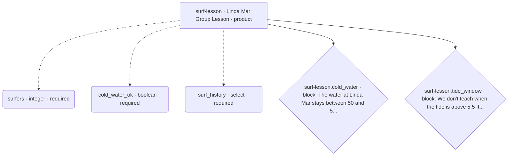

# Catalog format reference

A catalog is a directory: `business.yaml` plus one file per offering in
`offerings/`. The offering **id is the file name** without extension
(`offerings/surf-lesson.yaml` → `surf-lesson`). This reference mirrors
`src/catalog/schema.ts`; when in doubt, that file's doc comments are the
spec.

Scaffold a starting point with `npm run sg -- init`, check any
catalog with `npm run sg -- validate --catalog <dir>`, and when
something misbehaves ask `npm run sg -- doctor`.

## Conventions

- **Money** in major units (`40`, `12.50`); at most two decimals; never
  negative. Compiled internally to integer cents.
- **Percentages** as 0–100 (`15` means 15%).
- **Keys** (parameters, facts, groups, options, rules, adjustments): lower
  `snake_case`, `a-z 0-9 _`, starting with a letter, ≤ 64 chars. Offering ids
  may also use `-`.
- **Reserved names** — a parameter or fact may not be called any of:
  `all any not selected date dayOfWeek weekday isWeekend leadTimeHours
  leadTimeDays isPeak isOffPeak season`.
- Every object is `strict`: unknown keys are errors, not ignored.

## Condition shorthand (`when:`)

Used by rules, price adjustments (and package gates). All examples:

```yaml
when: { surf_history: first_time }               # equals
when: { surf_history: [first_time, whitewater] } # is one of
when: { surfers: { gte: 2, lte: 6 } }            # comparisons, all must hold
when: { selected: hire.foam_board }              # that option is selected
when: { selected: hire }                         # anything in that group
when: { all: [ ... ] }                           # AND
when: { any: [ ... ] }                           # OR
when: { not: { ... } }                           # NOT
when: { surf_history: first_time, tide_ft: { lte: 4 } } # several keys = all must hold
```

Comparison operators: `eq neq gt gte lt lte in not_in contains matches
exists`. A `<name>` is a parameter of the offering, a fact declared in
`business.yaml`, or a derived value (`dayOfWeek` `weekday` `isWeekend`
`leadTimeHours` `leadTimeDays` `isPeak` `isOffPeak` `season`). Evaluation is
three-valued: missing values are UNKNOWN; only definite TRUE fires (see
`docs/modeling.md`).

Regular expressions (`matches:` and a parameter's `pattern`) run on
[RE2](https://github.com/google/re2/wiki/Syntax), which takes time linear in
the input, so no pattern can stall the server. Agents read `pattern` from the
published questions, so a pattern must also mean the same in JavaScript.
`validate` refuses, naming the construct:

- more than 256 characters;
- backreferences (`\1`, `\k<name>`), lookahead (`(?=`, `(?!`), lookbehind;
- escapes other than `\d \D \w \W \s \S \b \B \t \n \r \f \v`, `\xHH` and
  escaped punctuation (`\.`, `\-`, `\/`, …) — e.g. `\a`, `\Q…\E`, `\x{41}`,
  `\A`, `\z`, `\pL`, `\p{…}`, `\C`, `\0` mean different things in the two;
- POSIX classes (`[[:alpha:]]`) and classes opening with `]` (`[]a]`, `[^]`);
- explicit repeat counts (`{n}`, `{n,m}` maxima) adding up to more than 1000,
  nested repeats multiplied (`(?:a{2}b{3}){250}` counts 1250), or a compiled
  RE2 program over 1200 instructions (long repeated alternations).

Remaining corner differences: `\s` is ASCII whitespace only, `.` also
matches `\r`, and `.` / classes match whole code points (one emoji is one
character). `matches` on a list (multiselect) tests each element and holds
when any element matches; a value or element over 512 characters is never
tested and counts as unknown.

## `business.yaml`

| Field | Type | Default | Notes |
|---|---|---|---|
| `name` | string | — | business name (required) |
| `description` | string | — | |
| `website` | URL | — | |
| `currency` | ISO 4217 | `USD` | one per catalog; two-decimal currencies only (`USD`, `EUR`, `GBP`, …) — others are an `UNSUPPORTED_CURRENCY` error |
| `timezone` | IANA | `UTC` | used for date-derived values and seasons |
| `taxRate` | percent | — | sales tax on taxable lines; omit for none |
| `facts` | map key → fact | — | server-supplied values (`src/extend/facts.ts`); shape below |
| `seasons` | list | — | date windows for `isPeak`/`isOffPeak`/`season` |
| `payments` | object | `{}` | payment behaviour — see [`payments`](#payments) below |
| `disclosure` | `progressive` \| `menu` | `progressive` | what buyer agents see before scoping. `progressive`: `describe_offering` / `GET /api/offerings/:id` return an overview only, and the engine reveals one question at a time. `menu`: they also list every question and add-on up front (gated ones marked `conditional: true`). See [`docs/connecting.md`](connecting.md#what-describe-returns) |
| `handoff` | object | — | `{ url, message }`; `url` must be an absolute http(s) URL whose scheme, host and port are literal (placeholders only in path, query or fragment); placeholders: `{offering} {total} {total_cents} {currency} {params} {business}` (`{offering}`/`{business}` are URL-encoded; `{params}` carries the qualified `summary` — under `disclosure: progressive` only the answers the buyer supplied — and skips any name the URL's own query already sets). `{total}`/`{params}` are a convenience for pre-filling: the booking page must re-check the price server-side (scope again, or use payments) and never trust the URL |

A fact: `{ type: string|number|boolean, description?, required? }`. Seasons
are described after the example below.

```yaml
name: Sea Stack Surf School
currency: USD
timezone: America/Los_Angeles
taxRate: 9
facts:
  tide_ft: { type: number, required: true }
seasons:
  - { name: summer_break, kind: peak, from: '06-20', to: '08-31' }
handoff:
  url: https://book.seastacksurf.example/new?offering={offering}&{params}
```

A season: `{ name, kind: peak|off_peak|custom, from?, to?, days?,
description? }` where dates are `YYYY-MM-DD` (one-off) or `MM-DD` (recurs
yearly, may wrap the year end), inclusive, and `days` is a list of
`sun…sat`. The derived `season` value is `'none'` when no season matches.

## `payments`

How a qualified quote becomes a charge. The block is optional and defaults
to owner-approval; it only takes effect when the server has Stripe
configured (`STRIPE_SECRET_KEY` — see [`docs/payments.md`](payments.md)).
These are business decisions: take them from the business owner, never
invent them.

| Field | Type | Default | Notes |
|---|---|---|---|
| `confirmation` | `owner_approves` \| `instant` | `owner_approves` | owner_approves holds the buyer's card and charges only when the owner approves; instant charges immediately (and is required for the MPP door) |
| `approvalWindowHours` | int 1–96 | `24` | hours the owner has to approve before the hold is released; automatically tightened to the service date and the card-hold expiry |
| `quoteTtlMinutes` | int 30–240 | `30` | how long a frozen quote stays payable |
| `successUrl` | URL | `PUBLIC_URL/orders/{order}` | where Stripe's hosted page returns the buyer; `{order}` placeholder |
| `cancelUrl` | URL | `PUBLIC_URL/orders/{order}` | where a buyer who abandons returns |

```yaml
payments:
  confirmation: owner_approves
  approvalWindowHours: 24
  quoteTtlMinutes: 60
  successUrl: https://book.example/orders/{order}?paid=1
```

## Offering files (`offerings/<id>.yaml`)

| Field | Type | Default | Notes |
|---|---|---|---|
| `kind` | `product` \| `package` | `product` | |
| `name` | string | — | required |
| `description` | string | — | |
| `category` | string | — | |
| `keywords` | list | `[]` | search/discovery |
| `status` | `active` \| `paused` \| `archived` | `active` | non-active are unavailable |
| `bookable` | boolean | `true` | `false` = only sold inside packages |
| `price` | money, `{ amount }` (flat), or `{ amount, per }` | — | **required for products**. Packages: fixed package price; omit to charge the sum of contents |
| `taxable` | boolean | `true` | is the base price taxable |
| `contains` | list | — | packages only: an offering id or `{ offering, quantity }` |
| `discount` | `{ percent }` or `{ amount }` | — | packages priced as a sum only |
| `date` | `none` \| `optional` \| `required` | `none` | must the buyer give a date |
| `minNoticeHours` | number | — | refuse dates closer than this; a date-only request counts from 00:00 of that day in the business `timezone` |
| `ask` | map key → parameter | — | buyer questions, in order |
| `choose` | map key → group | — | option groups, in order |
| `rules` | list | — | see below |
| `pricing` | list | — | price adjustments |
| `minimumSpend` | `{ amount, mode }` | — | mode: `decline` or `top_up` |

## Parameters (`ask:`)

| Field | Type | Default | Notes |
|---|---|---|---|
| `type` | `string number integer boolean date time datetime select multiselect` | — | required |
| `label` | string | humanized key | question text |
| `description` | string | — | help text |
| `required` | boolean | `true` | optional = asked only when needed |
| `options` | list of string or `{ value, label }` | — | select / multiselect |
| `min` / `max` | number | — | numeric bounds, or string length. Required: a parameter used as a base-price `per` needs `min ≥ 1`; parameters used by per-unit/tiered/formula adjustments need `min ≥ 0` |
| `pattern` | regex | — | string answers; RE2 syntax (see [conditions](#condition-shorthand-when)), ≤ 256 chars |
| `default` | scalar or list | — | counts as answered |
| `role` | `quantity` \| `fact` | — | quantity: a per-unit count; fact: an answer only a price adjustment needs; asked when pricing reads it |
| `internal` | boolean | — | never asked; value comes from `default` |

Answers: text is at most 512 characters and may contain tab and newline but
no other control characters; a multiselect answer lists each option at most
once.

```yaml
ask:
  surfers: { type: integer, min: 1, max: 10, role: quantity }
  surf_history: { type: select, options: [first_time, whitewater, open_face] }
  parking_on_site: { type: boolean, required: false, role: fact }
```

## Option groups (`choose:`) and options

| Field | Type | Default | Notes |
|---|---|---|---|
| `label` / `description` | string | key | |
| `mode` | `single` \| `multi` | `single` | |
| `required` | boolean | `false` | required groups are always asked |
| `min` / `max` | integer | — | min/max selections (multi) |
| `options` | list of keys, or map key → details | — | |

Option details: `{ label?, description?, price?, pricing?, taxable? }`.
`price` is money, `{ amount }` (flat) or `{ amount, per }` — an add-on charge
applied exactly when the option is selected. `pricing` is a list of full
adjustments (same shape as the offering's `pricing:`) applied only while the
option is selected — use it for what a flat `price` cannot say, e.g. a
per-paddler discount on a tandem craft.

A **product placed inside a package must not carry rules referencing its own
option groups** — group-dependent rules belong on the package.


```yaml
choose:
  hire:
    mode: multi
    options:
      foam_board: { label: Foam board, price: 20 }
      hooded_suit: { label: 5/4 hooded suit, price: { amount: 30, per: surfers } }
      tandem_kayak:
        label: Tandem kayak
        pricing:
          - { label: Tandem discount, kind: discount, amount: 10, per: paddlers }
```

## Rules

`when` (optional; absent = always) plus exactly **one** effect:

```yaml
rules:
  - id: cold_water                     # optional, for scenarios/traces
    when: { not: { cold_water_ok: true } }
    block: Every surfer must be comfortable in cold water   # refuse
  - when: { surf_history: first_time }
    require: hire.foam_board           # must be selected (asked first)
    message: First-timers learn on a foam board
  - when: { selected: hire.bodyboard }
    exclude: hire.foam_board           # must not be selected
    message: Choose a foam board or a bodyboard, not both
  - when: { selected: extras.photos }
    ask: photo_format                  # gate: only exists while when holds
```

Also: `description`, `priority` (int, lower first, default 0), `active`
(default true). Rule ids compile to `<offering>.<id>` (or
`<offering>.rule<N>`).

## Price adjustments (`pricing:`)

One `kind` + exactly one method:

```yaml
pricing:
  - { id: summer, label: Summer surcharge, kind: surcharge, percent: 20,
      basis: base, when: { isPeak: true }, reason: School holidays }
  - { label: Beach parking pass, kind: addon, amount: 6, per: surfers, order: 20 }
  - { label: Crew discount, kind: discount, per: surfers,
      tiers: [ { from: 0, to: 4, amount: 0 }, { from: 5, amount: 5 } ] }
  - { label: Session hours, kind: addon, formula: hours * 40 }
```

| Field | Notes |
|---|---|
| `id` | line id for scenarios (`<offering>.<id>`, else `<offering>.pricing<N>`) |
| `label` | shown on the quote (required) |
| `kind` | `addon` `surcharge` `discount` `fee` — sign and default `order` (100/300/200/400) |
| `when` | only definite TRUE applies the line |
| `amount` (+ `per`) | fixed, or × a parameter's value |
| `percent` (+ `basis`) | `running` (default) or `base` |
| `tiers` (+ `per`) | `{ from, to?, amount }`; quantity outside every tier = error |
| `formula` | arithmetic over parameter names; result in major units |
| `taxable` | default true; `false` keeps the line out of the tax base |
| `reason` | buyer-facing explanation |
| `order` | int, lower first |

Options' `price:` entries and `pricing:` lists compile to adjustments owned
by the option (ids `<offering>.<group>.<option>.price` /
`<offering>.<group>.<option>.pricing<N>`).

## Scenarios (`scenarios/*.yaml`)

Executable specs, run by `npm run scenarios`. A file is a bare list or
`{ defaults: { now, facts }, scenarios: [...] }`:

```yaml
defaults: { now: '2026-02-02T17:00:00Z' }
scenarios:
  - name: two first-timers on a Saturday
    offering: surf-lesson
    date: '2026-02-07'
    facts: { tide_ft: 3 }
    answers: { surfers: 2, cold_water_ok: true, surf_history: first_time }
    expect:
      status: qualified     # qualified | needs_input | blocked | invalid | unavailable
      total: 228.90
      lines: [ { label: Weekend surcharge, amount: 20 } ]
```

Scenarios are deterministic and never call `src/extend/facts.ts`: facts come
from the scenario's `facts:` or the file's `defaults.facts`, and `now` from
the scenario, the file default, or `2026-01-01T00:00:00Z` (in that order).

`expect` fields (all optional except `status`):

- `asks` — needs_input: the key of the question that should be asked first.
- `reason` — blocked: a reason **code** matched exactly (recommended), or a
  case-insensitive substring of a reason message (fallback).
- `rule` — blocked: the blocking rule id, full (`surf-lesson.cold_water`) or
  bare key (`cold_water`).
- `error` — invalid: the request field, i.e. `answers.<param>`,
  `selections.<group>` or `date`.
- `total` / `subtotal` / `tax` / `lines` — qualified: money in major units;
  `lines` match as a subset of the quote.

Codes to expect:

- blocked reasons: `RULE` `MINIMUM_SPEND` `DATE_IN_PAST` `DATE_TOO_SOON`
  `FACTS_UNAVAILABLE` `PRICING_ERROR`
- invalid errors: `UNKNOWN_FIELD` `INVALID_VALUE` `UNKNOWN_OPTION`
  `TOO_MANY_SELECTIONS` `INVALID_DATE` (fields `answers.<param>`,
  `selections.<group>`, `date`)
- unavailable codes: `NOT_FOUND` `NOT_ACTIVE` `NOT_BOOKABLE`
  `CONTENTS_UNAVAILABLE` (under `disclosure: progressive`, buyers over
  HTTP/MCP get `NOT_FOUND` for every offering that is not listed, and a
  `CONTENTS_UNAVAILABLE` message without product ids)
- needs_input reasons (why the engine asks): `date` (the offering needs a
  date), `required` (an unanswered required parameter), `rule_dependency`
  (a rule cannot be decided without this answer), `pricing_fact` (a price
  adjustment depends on this `role: fact` parameter), `pricing_input` (an
  applicable price line needs this quantity / formula input),
  `required_choice` (a required group is short of its minimum),
  `rule_requirement` (a fired `require` wants this group). `expect` asserts
  the question key (`asks`); the reason shows up in `simulate --explain`.

Full schema: `src/scenarios/schema.ts`.

## Editor support

`schema/` holds JSON Schemas for the three kinds of authoring file,
generated from the zod schemas (`src/catalog/schema.ts`,
`src/scenarios/schema.ts`):

| File | Schema |
|---|---|
| `catalog/business.yaml` | `schema/business.schema.json` |
| `catalog/offerings/<id>.yaml` | `schema/offering.schema.json` |
| `scenarios/*.yaml` | `schema/scenarios.schema.json` |

Every catalog and scenario file in this repo (and every file
`npm run sg -- init` writes) starts with a modeline naming its schema by a
path **relative to the file**:

```yaml
# yaml-language-server: $schema=../../schema/offering.schema.json
kind: product
name: Linda Mar Group Lesson
```

In VS Code, install the **YAML** extension (Red Hat,
`redhat.vscode-yaml`); it reads the modeline and gives completion, hover
enums and red squiggles for unknown keys, wrong types, bad key names and
out-of-range numbers as you type. Other editors that run
`yaml-language-server` (Neovim, Helix, Zed, JetBrains with the YAML plugin)
honour the same line. Keep it as the first line when you create a file:
`../schema/…` from `catalog/business.yaml` and `scenarios/`,
`../../schema/…` from `catalog/offerings/`.

The schemas check **shape only**, like the zod schemas they come from —
and slightly less: two-decimal money, "needs `id` or `label`" on a scenario
line, the condition grammar inside `when:` and every cross-reference
(does `hire.foam_board` exist?) are checked by `npm run validate` /
`npm run scenarios`, not by the editor. A clean editor is a good sign;
`validate` is still the gate.

After changing `src/catalog/schema.ts` or `src/scenarios/schema.ts`, run
`npm run schema` and commit `schema/`; a test fails while they are stale.

## Diagnostics worth knowing

`npm run validate` reports every problem with a stable code, and
`validate --strict` fails on warnings too. A few catch quoting mistakes
rather than typos:

- `UNSUPPORTED_CURRENCY` (error) — the catalog currency is not a
  two-decimal currency.
- `INVALID_PRICING` — an error for `per:` on an `internal` parameter (a
  per-unit line shows its quantity on the quote); a warning when tiers read a
  `type: number` parameter and leave gaps (3.5 falls between `to: 3` and
  `from: 4`, so pricing fails closed — use `integer`).
- `DISCOUNT_UNBOUNDED_QUANTITY` (warning) — a per-unit discount reads a
  parameter with no `max`, so the buyer decides how large the discount gets.
- `PERCENT_OF_ZERO_BASE` (warning) — a `basis: base` percent on an offering
  whose base price is 0 is always $0; use `basis: running`.
- `DATE_VALUE_WITHOUT_DATE` (warning) — a condition reads `isWeekend`,
  `season`, `leadTimeHours`, … but the offering has no `date:`, so it never
  applies.

## Inspecting the graph

`npm run sg -- graph` shows the compiled catalog — what the engine
actually evaluates, after every reference is resolved and every package is
flattened — without running the server:

```bash
npm run sg -- graph                                  # mermaid flowchart of every offering
npm run sg -- graph --offering surf-lesson           # just one offering
npm run --silent sg -- graph --format json           # the compiled graph as JSON
npm run --silent sg -- graph --format yaml --offering first-wave-weekend
npm run sg -- graph --format json --out graph.json   # write to a file instead of stdout
npm run sg -- graph --catalog catalog --format json --out starter.json
```

(`--silent` keeps npm's own banner out of stdout when you pipe or redirect;
`--out` never needs it.)

**`--format mermaid`** (default) prints a flowchart: offerings → option
groups → options, offerings ⇢ questions, offerings → rules → their targets,
packages ⇒ contained offerings. Paste it into a ```` ```mermaid ```` block
(GitHub renders it) or <https://mermaid.live>:



**`--format json`** / **`--format yaml`** print the compiled graph itself
(the `Graph` type in `src/graph/types.ts`) in a versioned envelope:

```json
{
  "scopegraphGraphVersion": 1,
  "business": { "currency": "USD", "facts": { … }, "name": "Sea Stack Surf School", "payments": { … }, "seasons": [ … ], "taxRateMicros": 90000, "timezone": "America/Los_Angeles", … },
  "offerings": {
    "surf-lesson": { "bookable": true, "contains": [], "date": "required", "id": "surf-lesson", "kind": "product", "name": "Linda Mar Group Lesson", "scope": { "adjustments": [ … ], "baseLines": [ … ], "inactiveContents": [], "optionGroups": [], "parameters": [ … ], "rules": [ … ] }, … }
  }
}
```

This is the compiled form, not the YAML you wrote: money is in integer
minor units (cents), percentages in millionths (`8.5%` →
`85000`), conditions as `{ ref, name, op, value }` leaves (`ref` is
`parameter`, `fact`, `derived` or `option`; `op` is the `when:` operator,
with `exists` carrying `value: true | false`) and `{ op: all | any | not,
conditions }` compounds, rule effects as `{ kind: block | require | exclude
| ask, … }`, rule and adjustment ids fully qualified
(`surf-lesson.cold_water`), and each offering's `scope` already holds
everything the engine evaluates for it (a package's own entries first,
then its products'). Object keys are sorted and absent fields omitted, so
the same catalog always produces the same bytes and exports diff cleanly;
arrays keep their order, which is meaningful (questions are asked, rules
run and adjustments apply in that order). `scopegraphGraphVersion` changes
only on a breaking change to this shape. With `--offering <id>`,
`offerings` holds just that offering.

**`--out <file>`** writes exactly what stdout would have shown to the file
and prints a one-line confirmation instead. It only writes `.json`, `.yaml`,
`.yml`, `.mmd`, `.mermaid` or `.md` files; never inside the catalog,
scenarios or `DATA_DIR` directory (however the path is spelled: symlinked
folders and letter-case variants count); and never through a symlink, over
anything but a regular file, or over a file with other hard links.

**`--json`** keeps the meaning it has on every command — a `{ ok, … }`
envelope on stdout for programs — and wraps whichever format you chose:
`{ ok, mermaid }` (unchanged), `{ ok, graph }` for `--format json`,
`{ ok, yaml }`, or `{ ok, format, out }` with `--out`. Errors are
`{ ok: false, error }` (or `{ ok: false, diagnostics }` when the catalog
does not compile) with exit code 1. To *read* the graph, use
`--format json` alone; add `--json` only when your program already
handles the `{ ok }` envelope of the other commands. Like every command,
`graph` refuses a catalog with errors — run `validate` first.
