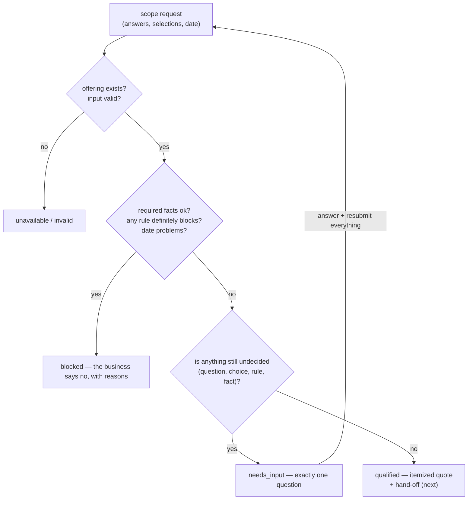

# Modeling a business in scopegraph

How to think in this vocabulary. For the exact YAML fields see
`docs/catalog-format.md`; for the loop (scenarios first, validate, simulate)
see `AGENTS.md`. To start from an empty scaffold run
`npm run sg -- init`; the example businesses in `examples/` (see
`examples/README.md`) are complete models to copy from. When something
won't behave, `npm run validate`,
`npm run simulate -- <offering> --explain`, and
`npm run sg -- doctor` say why; `npm run sg -- graph --format json`
shows the compiled model the engine actually evaluates (see "Inspecting
the graph" in `docs/catalog-format.md`).

## Offerings and packages

An **offering** is one file in `catalog/offerings/`; the file name is its id.
Two kinds:

- **product** — a single bookable thing with a base price. Sold alone, and
  usable inside packages. `price` is required.
- **package** — a composition. `contains:` lists products (optionally with a
  `quantity`). Either give the package its own fixed `price:` (the products
  become line items of the composition) or omit `price:` to charge the **sum**
  of the contained products' prices, optionally with a `discount:` (percent
  or amount) off that sum.

Inside a package, the contained products' **parameters, rules and price
adjustments flow in** (own first, then each product's, de-duplicated by
name). **Option groups do not flow in** — a package offers only its own
groups. Which means: **a product that goes into a package must not carry
rules referencing its own option groups** (the compiler rejects it — the
rule's group would be missing in the package's scope). If a group and the
rules around it should exist in both places, declare them separately on the
product for standalone sale and on the package for the package sale.
A package becomes unavailable if any contained product is paused or
archived. Set `bookable: false` on a product that may only be sold inside
packages.

## Parameters — the questions

Declared under `ask:` in the order the buyer should meet them.

- **required** (default) parameters are always asked. **Optional**
  parameters are asked only when something needs their value: a rule's
  `when` that cannot be decided without them, or (for `role: fact`) a price
  adjustment that depends on them. An optional parameter nobody references is
  never asked — it is just a field the caller may supply.
- **`role: quantity`** marks a count used by per-unit pricing (guests, hours,
  prints). If you write `price: { amount: 30, per: guests }` you need a
  `guests` parameter. A missing count is **asked for** (reason
  `pricing_input`) before pricing runs — it never silently prices as zero; a
  value pricing cannot use (a quantity outside every tier) fails closed
  (`PRICING_ERROR`).
- **`role: fact`** marks an answer that only a price adjustment needs ("is
  there parking on site?"): it is asked only when pricing reads it.
- **`internal: true`** — never asked of the buyer; the value comes from
  `default:`. Good for flags your own rules key off.
- A parameter with a `default:` counts as answered, so it is never asked.
- Validation: `options` (select/multiselect, each option at most once),
  `min`/`max` (numbers, or string length), `pattern` (string regex, run on
  RE2 — see `docs/catalog-format.md`); text answers are at most 512
  characters with no control characters except tab and newline. Bad input
  is `invalid`, which is a caller bug, not a business refusal.

Prefer select over free text whenever the answer drives rules or prices:
rules can only branch on values they can compare.

## Option groups — the add-ons

Declared under `choose:`. `mode: single` (pick one) or `multi` (pick any,
bounded by `min`/`max`). `required: true` means the buyer must make at least
one selection (`min` defaults to 1 then). A group's options are either a bare
key list or a map with details; **`price:` on an option is charged exactly
when that option is selected**, and an option may also carry a `pricing:`
list of full adjustments (discounts, per-unit charges, …) that apply only
while it is selected — put option-specific pricing on the option, never in
package-level `pricing:` gated on `{ selected: group.option }`.

An add-on a buyer either takes or skips is an optional `single` group holding
that one option. Sizes and levels (half-day/full-day hire, small/medium/large
dog) are options of one group, each priced as an add-on over the base.

**Optional groups are never asked; they are offered.** The engine only asks
for groups it needs (required ones, or one a fired `require` wants). A
qualified result lists the optional groups and options the buyer could still
choose as `addOns` (with price hints), and the MCP instructions tell agents
to offer them; a website should show them next to the quote. If the owner
wants every buyer to make an explicit choice before quoting, make the group
`required: true` with an explicit `none` option — ask the owner which they
want.

**Price set by a choice (size, level):** `price: 0` plus a `required: true`,
`mode: single` group whose options carry the prices. Percent surcharges must
then use `basis: running` — a `base` percent is a percentage of the base
price lines only, and a percentage of $0 is $0.

## Rules — what the business refuses and requires

A rule is `when:` (optional; absent = always) plus exactly one effect:

- `block: "<message>"` — refuse the request.
- `require: "<group>[.<option>]"` — that option (or any option of the group)
  must be selected.
- `exclude: "<group>[.<option>]"` — must not be selected.
- `ask: "<param|group>"` — a gate: that step exists only while `when` holds.

**Three-valued logic.** Every `when` evaluates to TRUE / FALSE / **UNKNOWN**
(a referenced value is missing). Only definite TRUE fires. Unknown never
blocks — the engine asks the buyer for the missing value instead (that is
rule-driven asking of optional parameters). Consequences:

- Write a requirement as a `block` that fires when it is *not* met:
  `when: { not: { riders: { lte: 12 } } }` + `block: Our boat takes up to 12
  riders`. A missing rider count is UNKNOWN → the engine asks; 15 riders is
  FALSE → NOT(FALSE) = TRUE → blocked. Writing `{ riders: { gt: 12 } }`
  would not fire for a missing count either (UNKNOWN > 12 is UNKNOWN), but
  the NOT form states the requirement directly and keeps working when the
  rule is edited later; prefer it.
- **Gates** (`ask:`) have OR semantics when several gate the same step: the
  step is open if **any** active gate's `when` is TRUE, closed if all are
  FALSE, and closed while any is UNKNOWN (a maybe-asked step stays hidden
  until its gate is decided). With `disclosure: menu`, `describe_offering`
  marks gated questions and choices `conditional: true`, so buyer agents
  don't ask them up front.
- **`require`** asks before it blocks: if the target (or its group) is
  unselected but the group is still empty, the engine surfaces that group
  once as the next question (`rule_requirement`, with the required option
  flagged). Only when the buyer answered the group and still did not pick the
  required option is the request blocked.

Rules carry optional `id`, `message` (for require/exclude), `priority` (lower
runs first; default 0) and `active`.

## Pricing — what it costs

Lines are produced in a fixed order:

1. **Base lines**: the offering's price (× its `per` parameter, × contained
   quantity), one line per contained product for sum-priced packages.
2. **Bundle discount** (`bundle_discount`): the package `discount:` — percent
   of the sum of base lines, or a fixed amount.
3. **Adjustments** — the offering's `pricing:` entries plus the price of
   every selected option — stable-sorted by `order` (defaults: addon 100,
   discount 200, surcharge 300, fee 400).

Each adjustment has a `kind` (decides sign and default order: `discount`
subtracts, `addon`/`surcharge`/`fee` add) and exactly one method:

- `amount` — fixed.
- `percent` (+ `basis`) — `running` (default) = percentage of the subtotal so
  far at this line's position; `base` = percentage of the base price lines
  only. With `base`, earlier add-ons don't change the amount; with
  `running`, every line before this one counts. A `price: 0` offering priced
  by its choices needs `running` (its base lines make every `base` percent $0).
  **Packages:** in a sum-priced package an inherited `basis: base` percent
  uses that product's own base lines; in a fixed-price package (no
  per-product lines) it uses the package price. So the starter's summer
  surcharge on the group lesson never lands on the private-session line of
  its sum-priced package.
  The package's own `base` adjustments (and its options') always take all of
  its base lines, and `running` is unchanged: the whole subtotal so far.
- `amount` + `per` — amount × the value of a quantity parameter.
- `tiers` + `per` — unit amount of the matching tier (from ≤ q ≤ to) × q.
  **Cover every quantity**: a quantity outside every tier is a configuration
  error (fail closed), so add a zero-amount tier for "no discount" ranges.
- `formula` — arithmetic over parameter names, e.g. `hours * 40`;
  result in major currency units.

Other fields: `when:` gates the line (only definite TRUE applies it);
`taxable: false` keeps the line out of the tax base; `reason:` is the
buyer-facing explanation shown on the quote; `id` names the line for
scenarios.

Arithmetic is exact (fractions, not floating point); each line is rounded to
cents once. **Sales tax** is business-wide (`taxRate` in
`catalog/business.yaml`), computed on the sum of taxable lines. **Minimum
spend** (`minimumSpend:` on an offering) compares the pre-tax subtotal:
`mode: top_up` adds a line for the shortfall, `mode: decline` blocks with
`MINIMUM_SPEND`.

## Facts and derived values

**Facts** are declared in `catalog/business.yaml` and supplied by your server
(`src/extend/facts.ts`) — see the trust boundary in `AGENTS.md`. Rules and
pricing conditions reference them like parameters. A `required: true` fact
that the server cannot supply blocks the request (`FACTS_UNAVAILABLE`) — fail
closed.

**Derived values** are computed from the requested `date` (and business
`seasons:`) — you reference them in `when:` conditions, you can never ask
them: `dayOfWeek` (0–6), `weekday` (`sun`…`sat`), `isWeekend`, `leadTimeHours`,
`leadTimeDays`, `isPeak`, `isOffPeak`, `season` (name of the matching
season, or `'none'` when nothing matches). These names (plus `all`, `any`,
`not`, `selected` and `date`) are reserved; `validate` rejects any other
name used in a condition. Without a date they are UNKNOWN — a rule that
reads them will ask for the date (if the offering takes one); a price
adjustment that reads them simply doesn't apply.

The whole loop, one picture — every `scope` call runs this deterministic
sequence and returns exactly one of five outcomes, never a partial answer:

## The question order the engine uses

For one `scope` call, after validation, required facts and the early block
pass (rules that are definitely TRUE with what's known):

1. the **date**, if the offering requires one and none was given;
2. the first unanswered **required parameter** in `ask` order (skipping
   `internal` ones and any whose gate is closed);
3. a parameter an undecided **rule** needs (`rule_dependency`), or the date
   if that rule reads a date-derived value;
4. a `role: fact` parameter an undecided **price adjustment** needs
   (`pricing_fact`);
5. a quantity or formula input an **applicable price line** needs
   (`pricing_input`) — asked even when a gate is closed, because otherwise
   pricing would fail closed with no way forward;
6. the first **required option group** short of its minimum (`required_choice`);
7. the group a fired **`require`** wants, asked once (`rule_requirement`).

If nothing is asked and no rule blocks, the request prices out → `qualified`.

## Common pitfalls

- **Never invent a price.** If the owner hasn't stated an amount, ask: a
  guessed number is charged to every buyer who qualifies.
- **Option charges belong on the option.** Don't model an add-on as a
  package-level adjustment gated on `{ selected: group.option }` — put
  `price:` (fixed or per-unit) on the option itself, or a full `pricing:`
  list on the option for discounts and anything a flat `price` can't say, so
  descriptions, price hints and quotes agree.
- **Per-unit pricing needs a quantity parameter — with bounds.**
  `{ amount, per }`, tiers and formulas all read a declared parameter. A
  base-price `per` needs `min ≥ 1`; parameters used by
  per-unit/tiered/formula adjustments need `min ≥ 0`. A missing input is
  asked when pricing needs it (`pricing_input`) — even behind a closed gate —
  so optional is fine; only `internal` parameters are never asked, and those
  need a `default`.
- **A product inside a package cannot carry rules on its own option
  groups** — the group isn't in the package's scope. Put group-dependent
  rules on the package that owns the group.
- **Don't duplicate parameters across a package's products** unless the
  definitions are identical — packages merge same-named parameters into one;
  definitions that differ (type, options, bounds, default) are a compile
  error (`PARAMETER_CONFLICT`), not a silent first-wins.
- **Shared policy rules on both products merge into the package** (each keeps
  its own offering-prefixed id). Identical block messages are reported once —
  the buyer reads a single reason, not one per product (the trace keeps every
  rule).
- **Rules are per offering.** A policy that applies to several offerings
  (min age, waiver, notice window) must be repeated in each offering's
  YAML. Inside a package the repeats collapse for the buyer (identical
  messages are reported once), but standalone offerings each need their own
  copy.
- **Weekend, peak-season or late-booking charges** go in `pricing:` with a
  `when:` on `isWeekend`, `isPeak`, `season` or `leadTimeHours`.
- **Tax applies to every line** unless that line sets `taxable: false` (for
  amounts your tax rules exempt).
- **Tier ladders must cover every quantity** including "no discount" ranges —
  a quantity outside all tiers errors (fail closed), it doesn't mean zero.
- **Discounts can't take a subtotal below zero**; the engine clamps the line
  and notes it in the trace. Don't stack discounts expecting otherwise.
- **A required group is not a question dump**: the engine asks one thing at a
  time in the order above; write `ask:`/`choose:` in the order a human
  receptionist would ask.
